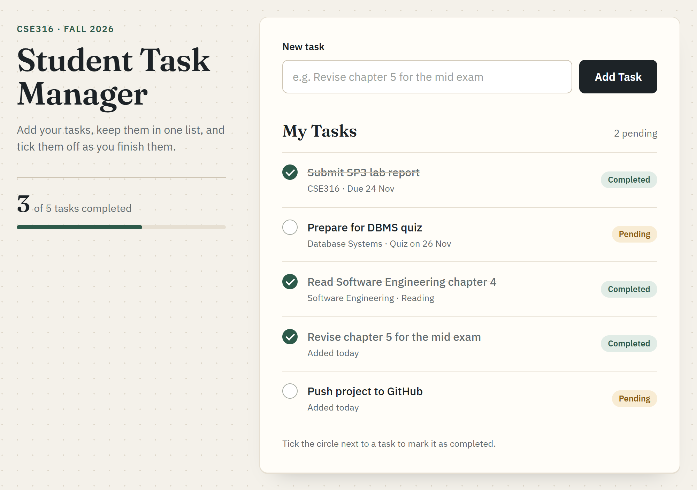
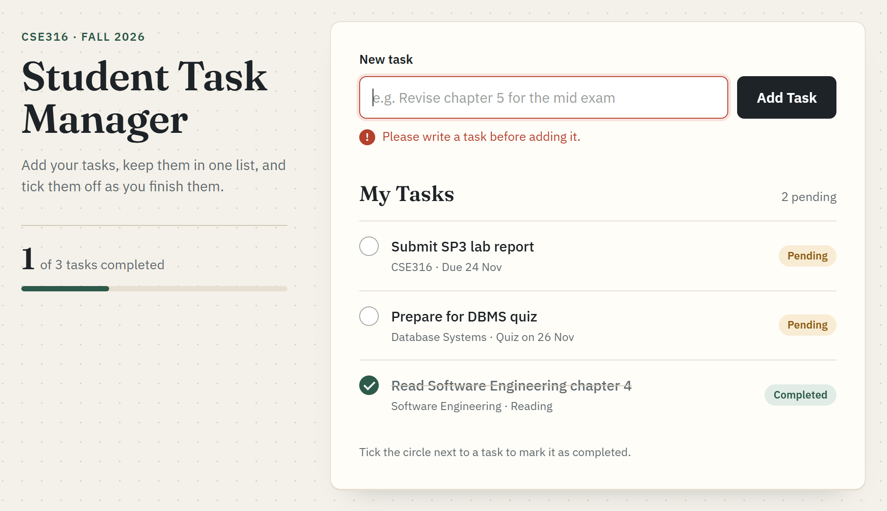
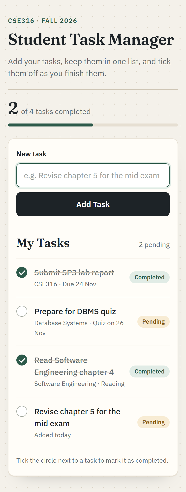

# Student Task Manager

A simple web application where students can add tasks, view their task list, and tick tasks off as they finish them. It was built step by step for the **Software Project III (CSE316)** lab at Daffodil International University, using only HTML, CSS, and JavaScript.



## Features

- **Add tasks**: type a task and click **Add Task** (or press Enter).
- **Empty-input validation**: an empty task is not added. The input turns red and a warning message is shown.
- **Mark as completed**: tick the round checkbox next to a task. The task is struck through and its status changes from *Pending* to *Completed*. Untick it to set it back to pending.
- **Progress tracker**: shows how many tasks are completed (for example, "3 of 5 tasks completed") with a progress bar and a pending count.
- **Responsive design**: two columns on desktop, one column on tablets and phones, and a stacked input and button on small phones. No horizontal scrolling at any width.
- **No setup needed**: plain HTML, CSS, and JavaScript with no frameworks, libraries, database, or backend.

## Project structure

```
student-task-manager/
├── index.html      # Page structure: title, progress, input area, task list
├── style.css       # Styling, Flexbox layout, and media queries
├── script.js       # Add task, validation, mark-as-completed, and progress logic
├── screenshots/    # Screenshots used in this README
└── README.md       # Project documentation
```

## How to run

1. Download or clone the repository:
   ```bash
   git clone https://github.com/iammominul/student-task-manager.git
   ```
2. Open the `student-task-manager` folder.
3. Double-click `index.html` to open it in any modern web browser (Chrome, Edge, or Firefox).

No installation or server is required. The page uses the Fraunces and IBM Plex Sans fonts from Google Fonts; without an internet connection it falls back to system fonts and still works.

## How to use

1. Type a task in the **New task** box.
2. Click **Add Task** or press **Enter**. The task appears at the bottom of the list as *Pending*.
3. Tick the circle next to a task to mark it as completed. The progress updates automatically.
4. Untick it to mark the task as pending again.

Tasks are kept only while the page is open. Refreshing the page resets the list, because saving tasks was not part of the lab requirements.

## Screenshots

| Empty-input warning | Mobile view |
|---|---|
|  |  |

## Technologies

- HTML5
- CSS3 (custom properties, Flexbox, media queries)
- JavaScript (DOM manipulation and events)

## Contributors

- **Mominul Islam** (ID: 192-15-13156, Section: RE_A(1C))

**Course:** Software Project III (CSE316), Daffodil International University  
**Course Teacher:** Pranto Protim Choudhury, Lecturer
